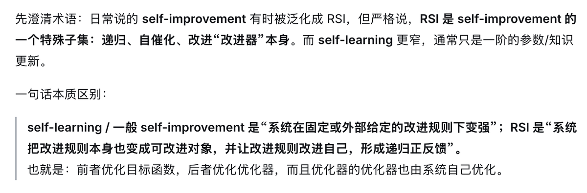

## 关于构建如何Self-learning的思考

突然发现我把Self-learning和RSI搞混了。Self-learning指的是提升知识储备，RSI指的是提升的获取知识的效率。-- 感谢池老师纠正

经过自己这两天的摸索，Self-learning的内容主要主要分成两类。Failures和Sugesstions

**Failures**

failies 指的是 agent执行过程中的失败模式。

就拿agent操作浏览器来访问浏网页来获取信息来举例子。

我遇到过下面两种情况：

\- 当agent需要访问一个博客时，它总是认为博客的内容在article标签里面。可实际上，很多博客都不是这样子的。

\- 当agent访问网站下的某个网页时，它偶尔会打开这个网站下面根本不存在的URL。

这都是因为模型的幻觉导致的，它压根没仔细阅读网站的结构，凭直觉做事。

**Suggestions**

Suggestions值的是给模型提供曾经成功过的模式。

同样的，就上面的例子来说:

\- 当agent访问到博客，需要提取信息时，你先告诉他曾经怎样做成功过

\- 当agent准备访问站点的其他网址，你先告诉他当前站点下曾经成功访问过的链接。

**理解这些不难，关键是在构建时如何保持上下文的简洁** 。历史的失败/成功模式会随着使用慢慢增加，而上下文窗口不会。

目前我的Self-learning内容，是通过对离线日志的分析得到的。最终会记录在一个markdown文件中，在调用skill时会访问这个文件。

**而为了避免上下文挤爆，我目前只记录失败的模式。成功的模式需要用户手动提示来创建。**

现在想想，这个方案非常粗糙。

如果一个站点频繁访问失败，那这个文件一定会又臭又长。我还没想好哪些失败的模式可以被剔除掉，又以什么方式被剔除掉。

对用户来说，还需要在agent中使用skill来创建，也确实很鸡肋。我想大概率不会有人愿意用

有点也有，这个Self-learning的流程很清晰。Capture、Analyse、Recall。就叫他CAR吧😂

字数 832 / 20000

<iframe allow="clipboard-write; web-share" src="chrome-extension://cnjifjpddelmedmihgijeibhnjfabmlf/side-panel.html?context=iframe"></iframe>